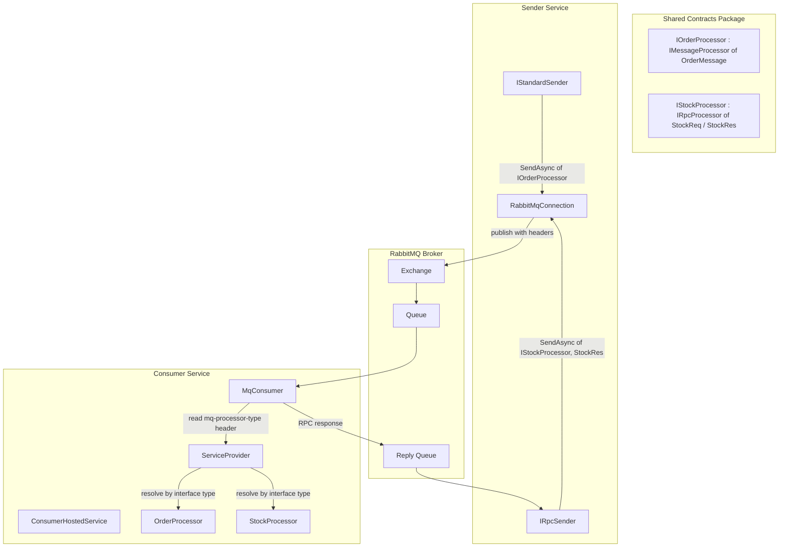

# Design Document: MqCSFramework

## Overview

MqCSFramework is a **three-module** RabbitMQ-only messaging framework. It provides compile-time type-safe sending via processor contract interfaces, automatic consumer dispatch using dependency injection resolution from message headers, and independent connection management per sender/consumer.

The three modules are:
- **MqCSFramework** — Core/shared: interfaces, models, exceptions, connection management, RPC response contract (`RpcResponse`/`RpcError`)
- **MqCSFramework.Sender** — Standard and RPC sender implementations, DI registration extensions
- **MqCSFramework.Consumer** — Consumer implementation, abstract processor base classes, DI registration extensions

The framework supports two messaging patterns:
- **Standard** (fire-and-forget): publish a message, no response expected
- **RPC** (request-reply): publish a request, await a typed response

The key design principle is **simplicity**: no transport abstraction, no routing tables, no processor registration at the consumer. The consumer resolves processors purely from the `mq-processor-type` header at runtime.

### Design Goals

1. Compile-time safety — the sender cannot send a message type that doesn't match the processor's expectation
2. Zero consumer configuration for processors — register in DI, the consumer auto-discovers via headers
3. Independent connections — each sender/consumer manages its own connection lifecycle
4. Minimal API surface — two sender interfaces, two processor base interfaces, direct DI container extensions

### Dependencies

| Dependency | Used By | Purpose |
|------------|---------|---------|
| RabbitMQ client library (fully async API) | Core, Sender, Consumer | Broker communication |
| Logging abstractions | Core, Sender, Consumer | Structured logging |
| DI abstractions (keyed/named services) | Sender, Consumer | DI registration |
| Configuration abstractions | Core | Reading config sections for the unknown-key check |
| Configuration binding | Sender, Consumer | Config binding |
| Hosting abstractions (background service) | Consumer | Background service hosting |
| JSON serializer (built-in) | All | Message serialization |

## Module Structure

```
src/
├── MqCSFramework/                          ← Core module (shared by Sender and Consumer)
│   ├── IMessageProcessor                   ← Non-generic + generic standard processor interfaces
│   ├── IRpcProcessor                       ← Non-generic + generic RPC processor interfaces
│   ├── LoggingExtensions                   ← CorrelationScope() extension method
│   ├── MessageContext                      ← Metadata data class passed to processors
│   ├── MqHeaders                           ← Well-known header name constants
│   ├── Configuration/
│   │   └── RabbitMqConnectionOptions       ← Connection settings (hosts with optional ports, credentials, SSL)
│   ├── RpcResponse                         ← Abstract base record all RPC responses extend (Error + derived Success)
│   ├── RpcError                            ← Error value object (Code + Message)
│   ├── Exceptions/
│   │   ├── MessageSerializationException
│   │   └── RpcTimeoutException
│   └── Internal/
│       ├── RabbitMqConnection              ← Lazy connection/channel management with auto-recovery
│       └── ConfigurationChecks             ← Unknown configuration key detection and logging
│
├── MqCSFramework.Sender/                   ← Sender module
│   ├── IStandardSender                     ← Public interface for fire-and-forget sends
│   ├── IRpcSender                          ← Public interface for RPC sends
│   ├── ServiceCollectionExtensions         ← AddMqSender, AddMqRpcSender, AddMqSendersFromConfiguration
│   ├── Configuration/
│   │   ├── StandardSenderOptions           ← Connection + Exchange + RoutingKey
│   │   ├── RpcSenderOptions                ← Connection + Exchange + RoutingKey + Timeout
│   │   ├── SendOptions                     ← Per-message overrides (RoutingKey, AdditionalHeaders)
│   │   └── RpcOptions                      ← Per-message overrides (RoutingKey, Timeout, AdditionalHeaders)
│   └── Internal/
│       ├── RabbitMqStandardSender          ← IStandardSender implementation
│       ├── RabbitMqRpcSender               ← IRpcSender implementation
│       └── RpcRequestResponseHandler       ← Reply queue management and correlation
│
└── MqCSFramework.Consumer/                 ← Consumer module
    ├── StandardProcessor                   ← Abstract base class for standard processors
    ├── RpcProcessor                        ← Abstract base class for RPC processors
    ├── ServiceCollectionExtensions         ← AddMqConsumer, AddMqConsumersFromConfiguration
    ├── Configuration/
    │   └── ConsumerOptions                 ← Connection + Queue + Prefetch + Retries + Timeout + DLX + Masking
    └── Internal/
        ├── ConsumerHostedService           ← Background service managing all consumers
        ├── MqConsumer                      ← Single consumer: connection, channel, dispatch loop
        ├── MessageHelpers                  ← Static helpers for header parsing and context building
        └── LogMaskingHelper                ← JSON field masking for log output
```

## Architecture



### Message Flow — Standard Pattern

1. Sender calls `IStandardSender.SendAsync<TProcessor, TMessage>(message, correlationId)`
2. Framework serializes message to UTF-8 JSON
3. Framework generates a `MessageId` as a new GUID in "N" format (32 hex digits, no hyphens)
4. Framework sets headers: `mq-processor-type` = the processor type's assembly-qualified name, `mq-pattern` = `"standard"`
5. Framework publishes to configured exchange/routing key via the channel's async publish method
6. On publish failure: logs error, resets channel, re-throws (a `PublishException` from a broker return or nack, only possible with `ConfirmPublish`, is re-thrown without resetting the channel)
7. Returns the generated `MessageId`

Consumer side:
1. Consumer receives message, reads `mq-processor-type` header
2. Consumer resolves the type by name → resolves from DI via the service provider
3. Casts to `IMessageProcessor` (non-generic) → calls `ProcessRawAsync(body, context, cancellationToken)`
4. Cancellation token created from `ConsumerOptions.ProcessingTimeoutMs`
5. On success: ACK. On failure: retry logic (increment `mq-retry-count`, dead-letter if exceeded)

### Message Flow — RPC Pattern

1. Sender calls `IRpcSender.SendAsync<TProcessor, TResponse, TRequest>(request, correlationId)`
2. Framework serializes request to UTF-8 JSON
3. Framework generates a fresh `MessageId` (new GUID in "N" format) for this attempt — this is the unique request/response match key. The caller's `correlationId` is a process-level trace id that may be shared across many messages and is NOT unique per request
4. Framework sets headers: `mq-processor-type`, `mq-pattern` = `"rpc"`, `mq-cancellation-deadline` = `(currentUtcTime + timeout).Ticks` as string. Sets `MessageId` = the generated match key and `CorrelationId` = the caller's trace id
5. `RpcRequestResponseHandler` makes sure its reply consumer is registered on the channel it is about to publish on: it lazily declares the exclusive auto-delete reply queue and starts consuming, and does so again under a new name whenever the connection hands out a different channel
6. Sets `ReplyTo` = the current reply queue name (format: `{routingKey}.reply.{GUID:N}`)
7. Registers a pending completion source keyed by `MessageId`, publishes, awaits response
8. On timeout: `RpcTimeoutException` (via linked cancellation with timeout). Timeout is a client-side concern — the sender stopped waiting. If `MaxExceptionRetries > 0`, the sender waits `ExceptionRetryDelay` and resends (with a NEW `MessageId`, same `correlationId`) before giving up (see RabbitMqRpcSender behavior); the final exception is thrown only after all attempts are exhausted
9. Consumer receives, resolves processor, calls `ProcessRawRpcAsync` which returns the serialized `TResponse` bytes
10. Consumer publishes those bytes directly to the `ReplyTo` queue, echoing the request's `MessageId` back on the reply's `MessageId` (so the sender can match it) and the request's `CorrelationId` on the reply's `CorrelationId` (for trace continuity). No wrapping envelope
11. Cancellation token for RPC processing: created from `mq-cancellation-deadline` header (remaining time until deadline)
12. If the processor throws an unexpected exception: nothing is published to the reply queue. The failure follows the standard NACK/retry/dead-letter path (see Error Handling). The sender observes a timeout
13. Sender matches the reply to the pending request by `MessageId`, then deserializes the reply bytes directly into `TResponse` (which extends `RpcResponse`). Business success/failure is read from `TResponse.Success`/`TResponse.Error` — set by the processor, not signaled by an exception

**Why match by `MessageId` and not `CorrelationId`:** `correlationId` identifies a logical process/transaction and is intentionally reusable across multiple messages (and across retries of one message), so it is not unique per request. Keying reply matching on it would let two concurrent calls that share a correlation id collide in the pending map (one reply resolving the wrong call). `MessageId` is generated fresh per message and per retry attempt, so it is the only correct match key. `correlationId` is reserved for logging/tracing on both the sender and the consumer.

## Components and Interfaces

### Module: MqCSFramework (Core)

#### Processor Contract Interfaces

**Interface: IMessageProcessor** (non-generic base)

The non-generic base interface for standard processors. The consumer calls `ProcessRawAsync` — the implementation deserializes and delegates to the typed method.

```
Method: ProcessRawAsync
Parameters:
  - body: byte buffer (read-only) - the raw message bytes
  - context: MessageContext - metadata about the message
  - cancellationToken: cancellation token (optional, default none)
Returns: asynchronous completion (void)
```

**Interface: IMessageProcessor\<TMessage\>** (generic, extends IMessageProcessor)

Generic interface for standard message processors. Define a contract interface inheriting this in your shared contracts module.

- Type constraint: `TMessage` must be a reference type (class)

```
Method: ProcessAsync
Parameters:
  - message: TMessage - the deserialized message
  - context: MessageContext - metadata about the message
  - cancellationToken: cancellation token (optional, default none)
Returns: asynchronous completion (void)
```

**Interface: IRpcProcessor** (non-generic base)

The non-generic base interface for RPC processors. The consumer calls `ProcessRawRpcAsync` — the implementation deserializes, processes, and serializes the response.

```
Method: ProcessRawRpcAsync
Parameters:
  - body: byte buffer (read-only) - the raw request bytes
  - context: MessageContext - metadata about the message
  - cancellationToken: cancellation token (optional, default none)
Returns: asynchronous method returning byte array (the serialized response)
```

**Interface: IRpcProcessor\<TRequest, TResponse\>** (generic, extends IRpcProcessor)

Generic interface for RPC processors that return a typed response. Define a contract interface inheriting this in your shared contracts module.

- Type constraints: `TRequest` must be a reference type (class), `TResponse` must extend `RpcResponse`

```
Method: ProcessAsync
Parameters:
  - request: TRequest - the deserialized request
  - context: MessageContext - metadata about the message
  - cancellationToken: cancellation token (optional, default none)
Returns: asynchronous method returning TResponse
```

#### MessageContext

```
Data class: MessageContext (immutable)
Properties:
  - MessageId: string (required)
  - CorrelationId: string (required)
  - Timestamp: datetime with timezone (required)
  - Pattern: string (required) - "standard" or "rpc"
  - Headers: read-only dictionary of string→string (required)
```

#### MqHeaders

Static class containing well-known header name constants used by the framework.

```
Constants:
  - ProcessorType = "mq-processor-type"
  - Pattern = "mq-pattern"
  - RetryCount = "mq-retry-count"
  - PatternStandard = "standard"
  - PatternRpc = "rpc"
  - CancellationDeadline = "mq-cancellation-deadline"
```

#### LoggingExtensions

Static utility providing a method to simplify creating a logging scope with a CorrelationId.

```
Method: CorrelationScope (extension on logger)
Parameters:
  - logger: the logger instance (implicit receiver)
  - correlationId: string - the correlation ID to include in all log entries within the scope
Returns: disposable scope object (or null)
Behavior:
  Creates a logging scope that includes the CorrelationId in all log entries within the scope.
  Requires the logging provider to support scope-based enrichment.
```

#### RabbitMqConnectionOptions

Configuration class for RabbitMQ connection settings. Each sender/consumer carries its own instance. All properties have defaults suitable for local development.

```
Class: RabbitMqConnectionOptions
Properties:
  - HostName: string (default "localhost") - one or more comma-separated "host" or "host:port" entries
      (the nodes of one cluster). An entry without a port uses 5672, or 5671 when UseSsl is true.
      There is no separate port property
  - UserName: string (default "guest")
  - Password: string (default "guest")
  - VirtualHost: string (default "/")
  - UseSsl: boolean (default false) - TLS for every host
  - SslServerName: string or null (default null) - certificate name checked for every host;
      when null or empty, each host is checked against its own name
  - ClientProvidedName: string or null (default null)
  - RequestedConnectionTimeout: duration (default 30 seconds) - budget per host for opening a
      connection (TCP connect, TLS, AMQP handshake); the whole connect is capped at this value
      times the number of hosts
  - ConfirmPublish: boolean (default false) - publisher confirms for every publish made through this
      connection (see Key Behaviors > Publisher Confirms). Recommended true for standard senders;
      less important for RPC senders, where a lost request already ends as a timeout
```

#### Exceptions

**Class: MessageSerializationException** (final/non-inheritable, extends base exception)

Thrown when message serialization or deserialization fails.

```
Properties:
  - MessageId: string or null
Constructor parameters:
  - message: string - error description
  - messageId: string or null (optional) - ID of the affected message
  - innerException: exception or null (optional) - the underlying cause
```

**Class: RpcTimeoutException** (final/non-inheritable, extends base exception)

Thrown when an RPC call times out waiting for a response.

```
Properties:
  - CorrelationId: string
  - Timeout: duration
Constructor parameters:
  - correlationId: string
  - timeout: duration
Message format: "RPC call {correlationId} timed out after {timeout.TotalSeconds}s"
```

Note: there is intentionally no `RpcRemoteException`. Remote processors do not send exceptions back to the sender. Business failures are expressed as an `RpcError` on the response (see `RpcResponse` below); unexpected processor exceptions follow the standard NACK/retry/dead-letter path and surface to the sender only as a timeout.

#### RpcResponse (Public, abstract)

Abstract base record that every RPC response type MUST extend. Carries the operation outcome. The concrete response record adds its own payload members. Lives in the core module so both consumer (processors) and sender (callers) reference it.

```
Abstract record: RpcResponse
Properties:
  - Error: RpcError or null (init-only) - null on success, populated on business failure
  - Success: boolean (computed, get-only) - defined as (Error is null); NOT settable, NOT independently serialized
Behavior:
  Success is derived from Error so the two can never disagree. A processor signals failure
  purely by setting Error; leaving Error null means success.
```

#### RpcError (Public)

Immutable value object describing a business failure. Both members are required together, so a partially-populated error state cannot exist.

```
Sealed record: RpcError
Properties:
  - Code: string (required) - machine-readable, service-specific error code (e.g. "SKU_NOT_FOUND"). Not a framework enum
  - Message: string (required) - human-readable description for logs/diagnostics
```

#### RabbitMqConnection (Internal)

Manages a single RabbitMQ connection and channel for a sender or consumer. Uses lazy initialization and relies on RabbitMQ client's built-in automatic recovery. Internal, shared across modules via internal visibility.

```
Class: RabbitMqConnection (final/non-inheritable, internal)
Implements: async disposable/cleanup pattern
Constructor parameters:
  - options: RabbitMqConnectionOptions
  - logger: logger instance

Method: GetChannelAsync
Parameters:
  - cancellationToken: cancellation token (optional, default none)
Returns: asynchronous method returning a channel object
Behavior:
  Returns existing open channel if available.
  Otherwise: closes stale channel, ensures connection is alive, creates new channel and attaches
  channel lifecycle logging to it.
  When options.ConfirmPublish is true the channel is created with channel options: publisher
  confirmations on, confirmation tracking on, outstanding-confirms rate limiter = a new
  ThrottlingRateLimiter(128) per channel, and consumerDispatchConcurrency = options.ConsumerDispatchConcurrency.
  The last one is passed explicitly because the channel-options constructor otherwise defaults it to 1,
  which would override the connection-level setting. When false, the channel is created without options.
  Thread-safe via semaphore (mutual exclusion lock).

Property: ConfirmPublish (boolean, read-only)
  Returns options.ConfirmPublish. Every publisher (standard sender, RPC request handler, consumer)
  passes it as the mandatory flag, so the flag and the channel's confirm mode always agree.

Method: ResetChannelAsync
Parameters: none
Returns: asynchronous completion (void)
Behavior:
  Closes and nulls the channel under lock.
  Forces a new channel on next GetChannelAsync call.

Internal behavior (CreateConnection):
  Creates a connection factory with:
    UserName, Password, VirtualHost from options
    AutomaticRecoveryEnabled = true
    TopologyRecoveryEnabled = true
    ClientProvidedName = options.ClientProvidedName
  Parses options.HostName with the client's multi-endpoint parser (AmqpTcpEndpoint.ParseMultiple:
    comma-separated, optional ":port", IPv6 in brackets). An entry without a port resolves to 5672,
    or 5671 once TLS is enabled on it.
  Gives each endpoint its own SSL option: enabled = options.UseSsl, ServerName = options.SslServerName
    when set, otherwise that endpoint's host (so a node presenting its own certificate validates
    against its own name).
  Calls the factory's async create connection method with the endpoint list. The client tries the
  endpoints in random order, for the initial connection and again on automatic recovery.
  Caps that call at options.RequestedConnectionTimeout x number of endpoints, using a token linked
  to the caller's. The client applies RequestedConnectionTimeout to the TCP connect only and can wait
  forever when a server accepts TCP but never answers the AMQP handshake (e.g. plaintext to a TLS port).
  When the cap (not the caller) cancels the connect, throws TimeoutException naming the endpoints;
  a caller's cancellation propagates unchanged.
  On success logs (Information) the endpoint it connected to and attaches connection lifecycle logging.

Lifecycle logging (diagnostics only; recovery itself is done by the client):
  Every line carries options.ClientProvidedName (or "unnamed").
  Connection:
    - ConnectionShutdownAsync: Information when the application closed it, otherwise Warning with
      initiator, reply code, reply text and the shutdown exception, plus the endpoint it was on
    - RecoverySucceededAsync: Information with the endpoint it reconnected to
    - ConnectionRecoveryErrorAsync: Error with the exception
    - CallbackExceptionAsync: Error with the exception
  Channel:
    - ChannelShutdownAsync: Information when the application closed it, otherwise Warning with
      initiator, reply code, reply text and the shutdown exception. A channel-level error closes
      only the channel and does not trigger the client's recovery, so this line is how it shows up
    - CallbackExceptionAsync: Error with the exception (e.g. thrown by a consumer's delivery handler)
  The current endpoint is remembered when connecting and updated on recovery, rather than read from
  the connection inside a shutdown handler: the client's Endpoint property throws once the
  connection is disposed.

DisposeAsync behavior:
  Closes channel and connection gracefully, disposes the semaphore.
```

#### ConfigurationChecks (Internal, static)

Unknown configuration key detection shared by the Sender and Consumer modules.

```
Method: FindUnknownKeys(section: configuration section, optionsType: type) -> read-only list of string
  Returns the full configuration path of every key under section that the configuration binder
  would not bind to optionsType, recursing into nested settings objects (e.g. Connection).
  A key matches a public instance property with a public setter, compared case-insensitively
  (the binder's rule). Recursion applies to class-typed properties other than string and
  collections; collection items and scalar values have no named keys to check.

Method: LogUnknownKeys(logger, unknownKeys: read-only list of string)
  For each key: log warning "Configuration key '{Key}' is not a known MqCSFramework setting and is
  ignored. It may be misspelled, or a setting that was renamed or removed."
```

Unknown keys are warnings, not errors, so a key that is disabled on purpose (e.g. renamed with a
prefix) or meant for a newer version does not stop the application.

### Module: MqCSFramework.Sender

#### IStandardSender

Public interface for sending standard (fire-and-forget) messages. The generic constraints enforce compile-time type safety between processor and message.

```
Interface: IStandardSender

Method: SendAsync
Type parameters:
  - TProcessor (must implement IMessageProcessor<TMessage>)
  - TMessage (must be a reference type / class)
Parameters:
  - message: TMessage - the message to send
  - correlationId: string - mandatory correlation identifier
  - options: SendOptions (optional, default null) - per-message overrides
  - cancellationToken: cancellation token (optional, default none)
Returns: asynchronous method returning string (the generated message ID)
```

#### IRpcSender

Public interface for sending RPC (request-reply) messages and awaiting a typed response. The generic constraints enforce compile-time type safety between processor, request, and response.

```
Interface: IRpcSender

Method: SendAsync
Type parameters:
  - TProcessor (must implement IRpcProcessor<TRequest, TResponse>)
  - TResponse (must extend RpcResponse)
  - TRequest (must be a reference type / class)
Parameters:
  - request: TRequest - the request to send
  - correlationId: string - mandatory correlation identifier
  - options: RpcOptions (optional, default null) - per-message overrides
  - cancellationToken: cancellation token (optional, default none)
Returns: asynchronous method returning TResponse (the deserialized response; inspect Success/Error for business outcome)
```

#### Configuration Options (Sender)

**Class: StandardSenderOptions** (final/non-inheritable)

Configuration for a standard (fire-and-forget) sender.

```
Properties:
  - Connection: RabbitMqConnectionOptions (default new instance)
  - Exchange: string (default "")
  - RoutingKey: string (default "")
  - TimeoutMs: integer milliseconds (default 20000) - upper bound for one send (connecting if needed,
    then publishing), applied together with the caller's cancellation token. 0 or less disables it.
```

**Class: RpcSenderOptions** (final/non-inheritable)

Configuration for an RPC (request-reply) sender.

```
Properties:
  - Connection: RabbitMqConnectionOptions (default new instance)
  - Exchange: string (default "")
  - RoutingKey: string (default "")
  - TimeoutMs: integer milliseconds (default 30000) - how long to wait for an RPC response before timing out
  - MaxExceptionRetries: integer (default 0) - number of ADDITIONAL attempts after the first on an
    exceptional failure (timeout, transport/connection error, or response deserialization failure).
    0 = no retry (preserves original single-attempt behavior).
  - ExceptionRetryDelayMs: integer milliseconds (default 1000) - delay waited before each retry attempt.
```

**Class: SendOptions** (final/non-inheritable)

Per-message options for standard sends (override sender defaults).

```
Properties:
  - RoutingKey: string or null - overrides default routing key
  - AdditionalHeaders: read-only dictionary of string→string or null - extra headers to include
```

**Class: RpcOptions** (final/non-inheritable)

Per-message options for RPC sends (override sender defaults).

```
Properties:
  - RoutingKey: string or null - overrides default routing key
  - TimeoutMs: integer milliseconds or null - overrides sender's TimeoutMs for this call
  - MaxExceptionRetries: integer or null - overrides sender's MaxExceptionRetries for this call
  - ExceptionRetryDelayMs: integer milliseconds or null - overrides sender's ExceptionRetryDelayMs for this call
  - AdditionalHeaders: read-only dictionary of string→string or null - extra headers to include
```

Note: `SendOptions` and `RpcOptions` do NOT have a `CorrelationId` property. The `correlationId` is a mandatory method parameter on both sender interfaces.

#### DI Registration Extensions (Sender)

Static utility class providing extension methods for registering sender services in the DI container.

**Method: AddMqSender**

Registers a standard (fire-and-forget) sender as a keyed/named singleton implementing IStandardSender.

```
Parameters:
  - services: the DI service collection (implicit receiver)
  - name: string - the key/name to register under (must not be null or whitespace)
  - configure: callback accepting StandardSenderOptions - configures the sender
Returns: the service collection (for chaining)
Behavior:
  Validates name is not null/whitespace.
  Creates StandardSenderOptions, invokes the configure callback.
  Registers a keyed singleton factory that:
    - Resolves a logger from the service provider
    - Logs the unknown configuration keys collected at registration (ConfigurationChecks.LogUnknownKeys;
      none for this manual overload)
    - Creates a new RabbitMqConnection with the configured options
    - Creates and returns a new RabbitMqStandardSender
  Both public methods delegate to one private registration method that takes the unknown keys.
```

**Method: AddMqRpcSender**

Registers an RPC (request-reply) sender as a keyed/named singleton implementing IRpcSender.

```
Parameters:
  - services: the DI service collection (implicit receiver)
  - name: string - the key/name to register under (must not be null or whitespace)
  - configure: callback accepting RpcSenderOptions - configures the sender
Returns: the service collection (for chaining)
Behavior:
  Validates name is not null/whitespace.
  Creates RpcSenderOptions, invokes the configure callback.
  Registers a keyed singleton factory that:
    - Resolves a logger from the service provider
    - Logs the unknown configuration keys collected at registration (none for this manual overload)
    - Creates a new RabbitMqConnection with the configured options
    - Creates and returns a new RabbitMqRpcSender
```

**Method: AddMqSendersFromConfiguration**

Auto-registers all senders and RPC senders from the given config section. Reads "Senders" and "RpcSenders" sub-sections.

```
Parameters:
  - services: the DI service collection (implicit receiver)
  - configuration: configuration root object
  - sectionName: string (optional, default "MqCSFramework") - config section name
Returns: the service collection (for chaining)
Behavior:
  Gets the config section by sectionName.
  Iterates "Senders" children: for each, registers a standard sender with child key as name, binding
    options from config, and passes ConfigurationChecks.FindUnknownKeys(child, StandardSenderOptions).
  Iterates "RpcSenders" children: same with RpcSenderOptions.
```

#### RabbitMqStandardSender (Internal)

Standard (fire-and-forget) sender implementation. Each instance owns its own connection. Final/non-inheritable, internal.

```
Class: RabbitMqStandardSender
Implements: IStandardSender
Constructor parameters:
  - connection: RabbitMqConnection
  - options: StandardSenderOptions
  - logger: logger instance

SendAsync behavior:
  1. Generate messageId = new GUID in "N" format (32 hex, no hyphens)
  2. Determine routingKey = options.RoutingKey if provided, else sender's default RoutingKey
  3. Serialize message to UTF-8 JSON bytes
     - On serialization failure: throw MessageSerializationException with messageId
  4. Build message properties:
     - MessageId = generated messageId
     - CorrelationId = the correlationId parameter
     - Timestamp = current UTC time as Unix epoch seconds
     - ContentType = "application/json"
     - Persistent = true (delivery mode 2)
     - Headers:
       - "mq-processor-type" = TProcessor's assembly-qualified type name
       - "mq-pattern" = "standard"
  5. Merge any AdditionalHeaders from options into the headers
  6. Link the caller's cancellation token with options.TimeoutMs (when > 0); get channel from
     connection and publish message asynchronously (mandatory = connection.ConfirmPublish), both with
     the linked token. With confirms on, the publish completes only after the broker's ack
  7. On PublishException (broker returned or rejected the message; only with confirms on):
     - Log error with messageId, exchange, routingKey
     - Re-throw WITHOUT resetting the channel (it is still healthy)
  8. On any other publish failure (any exception except MessageSerializationException):
     - Log error with messageId, exchange, routingKey
     - Call connection.ResetChannelAsync()
     - If the failure is a cancellation caused by TimeoutMs (not by the caller's token):
       throw TimeoutException wrapping it
     - Otherwise re-throw the exception
  9. Log info: published standard message with messageId, processor name, exchange, routingKey
  10. Return messageId
```

#### RabbitMqRpcSender (Internal)

RPC (request-reply) sender implementation. Delegates reply correlation entirely to RpcRequestResponseHandler. Final/non-inheritable, internal. Implements async disposable/cleanup pattern.

```
Class: RabbitMqRpcSender
Implements: IRpcSender, async disposable/cleanup pattern
Constructor parameters:
  - connection: RabbitMqConnection
  - options: RpcSenderOptions
  - logger: logger instance
Constructor behavior:
  Creates a RpcRequestResponseHandler with the connection, the reply queue prefix
  "{options.RoutingKey}.reply.", and logger. The handler appends a new GUID each time it registers
  the reply consumer, and sets ReplyTo itself.

SendAsync behavior:
  1. Determine routingKey = options.RoutingKey if provided, else sender's default RoutingKey
  2. Determine timeout = TimeSpan.FromMilliseconds(options.TimeoutMs ?? sender's TimeoutMs). Options are
     expressed in integer milliseconds; convert to TimeSpan once here for the internal time math
     (cancellation deadline, PublishAndAwaitReplyAsync)
  3. Determine maxExceptionRetries = options.MaxExceptionRetries if provided, else sender's MaxExceptionRetries
  4. Determine exceptionRetryDelayMs = options.ExceptionRetryDelayMs if provided, else sender's ExceptionRetryDelayMs
     (kept as integer milliseconds; passed directly to Task.Delay(int, ct))
  5. Serialize request to UTF-8 JSON bytes ONCE, before the retry loop
     - On serialization failure: the serializer exception propagates immediately and is never retried
       (a bad request object fails identically every attempt and never reaches the broker)
  6. A single attempt is performed by a private helper (SendAttemptAsync) that:
     a. Generates messageId = new GUID in "N" format (fresh per attempt — this is the match key)
     b. Builds message properties:
        - MessageId = generated messageId (unique per attempt; the reply match key)
        - CorrelationId = the correlationId parameter (stable trace id, reused across attempts and shareable across messages)
        - ReplyTo = the reply queue name
        - Timestamp = current UTC time as Unix epoch seconds
        - ContentType = "application/json"
        - Persistent = true (delivery mode 2)
        - Headers:
          - "mq-processor-type" = TProcessor's assembly-qualified type name
          - "mq-pattern" = "rpc"
          - "mq-cancellation-deadline" = (currentUtcTime + timeout).Ticks as string (recomputed per attempt)
        - Merge any AdditionalHeaders from options into the headers
     c. Logs info: publishing RPC request with messageId, processor name, exchange, routingKey, attempt number
     d. Calls replyConsumer.PublishAndAwaitReplyAsync(exchange, routingKey, props, body, messageId, correlationId, timeout, ct)
        (pending is keyed by messageId; correlationId is passed only for timeout-exception context)
     e. Deserializes the response bytes directly as TResponse (no envelope)
     f. If the deserialized response is null: throw MessageSerializationException("failed to deserialize", messageId)
     g. Returns the deserialized TResponse (caller inspects Success/Error for the business outcome)

  7. Retry loop structure — a `while (true)` whose catch filter carries BOTH the retryable check and the
     retries-remaining check, so there is no separate "final attempt" block to duplicate:
     ```
     var attempt = 0;
     do
     {
         try { return await SendAttemptAsync(..., attempt, ct); }
         // Caught (and retried) ONLY when the failure is exceptional AND retries remain. On the last
         // attempt, a caller cancellation, or a non-exceptional failure, the exception is NOT caught
         // and propagates to the caller.
         catch (Exception ex) when (ex is not (OperationCanceledException or PublishException) && attempt < maxExceptionRetries)
         {
             log warning (attempt+1 of maxExceptionRetries+1, delayMs);
             await Task.Delay(exceptionRetryDelayMs, ct);   // honors ct; throws on caller cancel
             attempt++;
         }
     }
     while (attempt <= maxExceptionRetries);
     throw new UnreachableException();   // unreachable; satisfies CS0161 (see note below)
     ```
     - Total attempts = maxExceptionRetries + 1 (one initial + N retries). When maxExceptionRetries == 0
       the catch filter is false on the first failure, so there is exactly one attempt.
     - The `attempt < maxExceptionRetries` guard that decides whether to retry lives in the catch `when`
       filter (NOT the loop condition). The loop never exits via its `while` condition — it exits only via
       `return` (success) or a propagated exception — so the trailing `throw new UnreachableException()` is
       dead code required only to satisfy definite-return analysis (CS0161: not all code paths return a
       value). This keeps the loop with no trailing final-attempt call and no rethrow-on-last-attempt branch.
     - Do NOT add an explicit `ct.ThrowIfCancellationRequested()` inside the catch. It is redundant:
       `await Task.Delay(exceptionRetryDelay, ct)` already throws OperationCanceledException if the caller
       cancels (now or during the wait), abandoning the retry. Rely on that.

  Retry predicate (`ex is not (OperationCanceledException or PublishException)`, inlined directly in the
  catch `when` filter — do NOT extract it into a helper method): EVERYTHING is retryable EXCEPT a
  caller-driven cancellation and a PublishException.
  A timeout surfaces as RpcTimeoutException (retried); a caller cancelling their CancellationToken
  surfaces as OperationCanceledException (NOT retried, because the caller explicitly asked to stop —
  retrying would ignore their intent). These are produced as two distinct exceptions by
  RpcRequestResponseHandler on purpose (see its PublishAndAwaitReplyAsync).
  A PublishException (only with ConfirmPublish: the broker returned the request because no queue
  matched, or rejected it) is NOT retried: no consumer will answer that request and the channel is
  healthy, so the caller gets it at once instead of an RpcTimeoutException after the full timeout.

Note on match key, retry correlation, and idempotency:
  Each attempt uses a fresh messageId as the pending-map key, so a late reply to a prior (already
  timed-out) attempt finds no pending entry and is discarded by the autoAck reply consumer — it can
  never resolve the current attempt. The caller's correlationId is reused across attempts purely for
  tracing and is never used for matching (it is not unique per message). Because a retry resends the
  SAME request, exception-retry is only safe for idempotent operations: a lost/late reply can cause the
  consumer to process the request more than once. A business failure (Success=false) is a normal return
  value (not an exception), so it is handed straight back to the caller and is never retried.

DisposeAsync behavior:
  Disposes the reply consumer, then disposes the connection.
```

#### RpcRequestResponseHandler (Internal)

Manages the reply queue consumer for RPC responses. Owns the pending request dictionary and handles the full correlation lifecycle: ensure started, register pending, publish, await reply, timeout, cleanup. Final/non-inheritable, internal. Implements disposable/cleanup pattern.

```
Class: RpcRequestResponseHandler
Implements: disposable/cleanup pattern
Fields:
  - connection: RabbitMqConnection
  - replyQueuePrefix: string ("{routingKey}.reply.")
  - logger: logger instance
  - initLock: semaphore (initially 1)
  - pending: concurrent/thread-safe dictionary of string → completion source of byte array
  - registration: volatile reference to an immutable (channel, queueName) pair, or null before first use.
      The channel the reply consumer is registered on and the queue it consumes, replaced together in
      one assignment so readers never see a channel paired with another channel's queue name
Constructor parameters:
  - connection: RabbitMqConnection
  - replyQueuePrefix: string
  - logger: logger instance

Method: PublishAndAwaitReplyAsync
Parameters:
  - exchange: string
  - routingKey: string
  - props: message properties
  - body: byte array
  - messageId: string - the unique per-message match key (also set on props.MessageId by the sender)
  - correlationId: string - the process-level trace id (used only for RpcTimeoutException context/logging)
  - timeout: duration
  - cancellationToken: cancellation token
Returns: asynchronous method returning byte array (the raw response bytes)
Behavior:
  1. Call EnsureReplyConsumerAsync to get the (channel, queueName) registration; set props.ReplyTo = queueName
  2. Create a new completion source (with RunContinuationsAsynchronously flag)
  3. Store it in the pending dictionary keyed by messageId (NOT correlationId — correlationId is not unique per message)
  4. Create a linked cancellation source (from the caller's token) that also cancels after the timeout duration
  5. Register a cancellation callback: remove the pending entry (by messageId), then — if the caller's token
     caused the cancellation — complete the pending task as canceled (OperationCanceledException); otherwise
     (the timeout fired) set RpcTimeoutException. This lets callers and the sender's exception-retry logic
     distinguish a caller cancellation (not retryable) from a timeout (retryable)
  6. Publish the message on the registration's channel, the one the reply consumer listens on
     (mandatory = connection.ConfirmPublish; with confirms on, the publish awaits the broker's ack and
     a return or nack throws PublishException)
  7. Await the completion source's result
  8. On failure before completion: remove pending entry (by messageId), re-throw

Method: EnsureReplyConsumerAsync (private)
Parameters:
  - cancellationToken: cancellation token
Returns: the current (channel, queueName) registration
Behavior:
  Get channel from connection. If the registration exists and its channel is that same instance,
  return it (fast path, no lock).
  Acquire the init lock; repeat the check with a fresh GetChannelAsync (double-checked locking).
  Otherwise (first use, or the connection handed out a different channel because the previous one
  closed, or the connection itself was rebuilt):
    queueName = replyQueuePrefix + new GUID ("N"). A new name every time: if the previous connection
    died without a clean close, the broker can keep its exclusive queue until it notices, and
    redeclaring that name would fail with RESOURCE_LOCKED.
    Declare queue: name=queueName, durable=false, exclusive=true, autoDelete=true, no arguments.
    Create an async event consumer, attach HandleReplyAsync to its received event.
    Start consuming with autoAck=true.
    Store the new (channel, queueName) registration.
    Log info "RPC reply consumer started on queue '{ReplyQueue}'" on first use, or warning
    "RPC channel was replaced; reply consumer re-registered on queue '{ReplyQueue}' (was '{OldReplyQueue}')".
  Release the lock.
  Comparing channel instances is what makes this safe with automatic recovery: the client recovers a
  channel in place (same instance) and re-registers its consumers itself, so no second consumer is
  added; only a channel instance the framework created anew gets a fresh registration.
  Requests already published with the old ReplyTo get no reply (their queue is gone) and time out.

Method: HandleReplyAsync (private, event handler)
Behavior:
  Read messageId from the incoming reply's MessageId property.
  If messageId is null, ignore.
  If a pending entry exists for that messageId, remove it and set the result to the message body bytes.
  (An unmatched reply — e.g. a late reply to an attempt that already timed out and was removed — is
  silently discarded; the reply consumer uses autoAck.)

Dispose behavior:
  Cancel all pending completion sources.
  Dispose the semaphore.
```

### Module: MqCSFramework.Consumer

#### ConsumerOptions

Configuration class for a message consumer. Final/non-inheritable.

```
Class: ConsumerOptions
Properties:
  - Connection: RabbitMqConnectionOptions (default new instance)
  - QueueName: string (default "")
  - PrefetchCount: unsigned short integer (default 10)
  - MaxRetries: integer (default 3)
  - ProcessingTimeoutMs: integer (default 30000)
  - DeadLetterExchange: string or null (default null)
  - DeadLetterRoutingKey: string or null (default null)
  - MaskedFields: read-only list of strings (default empty list)
```

Note: `ConsumerOptions` does NOT have a `SuppressMessageBodyLogging` property. Body logging is at debug level and is controlled via per-namespace log level overrides in configuration.

#### Abstract Processor Base Classes

These are in the Consumer module. Developers inherit from them in their processor implementations.

**Abstract class: StandardProcessor\<TMessage\>**

Implements `IMessageProcessor<TMessage>`. Handles deserialization internally — the consumer calls `ProcessRawAsync` directly (no reflection).

- Type constraint: `TMessage` must be a reference type (class)

```
Method: ProcessRawAsync (concrete implementation)
Behavior:
  1. Deserialize body bytes as TMessage using JSON
  2. If deserialization returns null: throw MessageSerializationException with context.MessageId
  3. Call the abstract ProcessAsync method with the deserialized message

Method: ProcessAsync (abstract, must be overridden)
Parameters:
  - message: TMessage
  - context: MessageContext
  - cancellationToken: cancellation token (optional, default none)
Returns: asynchronous completion (void)
```

**Abstract class: RpcProcessor\<TRequest, TResponse\>**

Implements `IRpcProcessor<TRequest, TResponse>`. Handles deserialization and response serialization internally — the consumer calls `ProcessRawRpcAsync` directly (no reflection).

- Type constraints: `TRequest` must be a reference type (class), `TResponse` must extend `RpcResponse`

```
Method: ProcessRawRpcAsync (concrete implementation)
Behavior:
  1. Deserialize body bytes as TRequest using JSON
  2. If deserialization returns null: throw MessageSerializationException with context.MessageId
  3. Call the abstract ProcessAsync method with the deserialized request
  4. Serialize the TResponse result to UTF-8 JSON bytes
  5. Return the serialized bytes

Method: ProcessAsync (abstract, must be overridden)
Parameters:
  - request: TRequest
  - context: MessageContext
  - cancellationToken: cancellation token (optional, default none)
Returns: asynchronous method returning TResponse
```

#### DI Registration Extensions (Consumer)

Static utility class providing extension methods for registering consumer services in the DI container.

**Method: AddMqConsumer**

Registers a consumer that listens on a queue and dispatches messages to processors. Also registers the background hosted service (idempotent — only one instance runs regardless of how many consumers are added).

```
Parameters:
  - services: the DI service collection (implicit receiver)
  - name: string - the consumer name (must not be null or whitespace)
  - configure: callback accepting ConsumerOptions - configures the consumer
Returns: the service collection (for chaining)
Behavior:
  Validates name is not null/whitespace.
  Creates ConsumerOptions, invokes the configure callback.
  Stores a ConsumerRegistration(name, options, unknownKeys) as a singleton in DI (unknownKeys empty
    for this manual overload; both public methods delegate to one private method that takes them).
  Registers the ConsumerHostedService as a hosted/background service (idempotent).
```

**Method: AddMqConsumersFromConfiguration**

Auto-registers all consumers from the given config section. Reads the "Consumers" sub-section.

```
Parameters:
  - services: the DI service collection (implicit receiver)
  - configuration: configuration root object
  - sectionName: string (optional, default "MqCSFramework") - config section name
Returns: the service collection (for chaining)
Behavior:
  Gets the config section by sectionName.
  Iterates "Consumers" children: for each, registers a consumer with child key as name, binding options
    from config, and passes ConfigurationChecks.FindUnknownKeys(child, ConsumerOptions).
```

#### ConsumerRegistration (Internal)

```
Data class: ConsumerRegistration (immutable, internal)
Properties:
  - Name: string
  - Options: ConsumerOptions
  - UnknownKeys: read-only list of strings - configuration paths that matched no setting
```

#### ConsumerHostedService (Internal)

Background service that starts and manages all registered consumers. Final/non-inheritable, internal.

```
Class: ConsumerHostedService
Extends: background/hosted service base class
Fields:
  - registrations: read-only list of ConsumerRegistration
  - scopeFactory: IServiceScopeFactory
  - loggerFactory: logger factory
  - logger: logger instance
  - consumers: mutable list of MqConsumer
Constructor parameters:
  - registrations: collection of ConsumerRegistration (injected from DI)
  - scopeFactory: IServiceScopeFactory
  - loggerFactory: logger factory
  - logger: logger instance

Execute behavior (runs on background thread):
  1. If no registrations: log warning "No consumers registered", idle indefinitely until cancellation, return
  2. Log info "Starting {Count} consumer(s)"
  3. For each registration:
     - ConfigurationChecks.LogUnknownKeys(logger, registration.UnknownKeys)
     - Create a new MqConsumer with registration.Options, scopeFactory, and a new logger
     - Add to consumers list
     - Call consumer.StartAsync(cancellationToken)
  4. Log info "All consumers started"
  5. Idle indefinitely until cancellation token fires
  6. Log info "Shutdown requested. Disposing consumers..."
  7. For each consumer: call DisposeAsync
```

#### MqConsumer (Internal)

Manages a single consumer — owns its connection, channel, and message dispatch loop. Resolves processors from a per-message DI scope using the `mq-processor-type` header, ensuring scoped dependencies (e.g. DbContext) are not shared across messages. Final/non-inheritable, internal. Implements async disposable/cleanup pattern.

```
Class: MqConsumer
Implements: async disposable/cleanup pattern
Fields:
  - options: ConsumerOptions
  - scopeFactory: IServiceScopeFactory
  - logger: logger instance
  - maskedFields: set of strings (case-insensitive) or null
    Built from options.MaskedFields if non-empty, null otherwise.
  - connection: RabbitMqConnection or null
  - channel: channel object or null
Constructor parameters:
  - options: ConsumerOptions
  - scopeFactory: IServiceScopeFactory
  - logger: logger instance

Method: StartAsync
Parameters:
  - cancellationToken: cancellation token
Behavior:
  1. Create a new RabbitMqConnection with options.Connection and the logger
  2. Get a channel from the connection
  3. Declare queue (idempotent): name=options.QueueName, durable=true, exclusive=false, autoDelete=false, no arguments
  4. Set prefetch: prefetchSize=0, prefetchCount=options.PrefetchCount, global=false
  5. Create an async event consumer, attach DispatchMessageAsync to its received event
  6. Start consuming: queue=options.QueueName, autoAck=false
  7. Log info: "Consumer started on queue '{QueueName}' with prefetch {PrefetchCount}"
```

**Method: DispatchMessageAsync** (event handler)

```
Behavior:
  1. Read MessageId from message properties (fallback: "unknown")
  2. Read CorrelationId from message properties (fallback: messageId)
  3. Wrap all processing in a logging scope via logger.CorrelationScope(correlationId)
  4. Call DispatchMessageCoreAsync
```

**Method: DispatchMessageCoreAsync** (private)

Dispatch logic:
1. Read `mq-processor-type` header → if missing, log warning + NACK without requeue, return
2. Resolve type by name from the header value → if null (type not found), log error + NACK without requeue, return
3. Create a new DI scope via `scopeFactory.CreateScope()` (disposed when message processing finishes)
4. Resolve service from the scoped provider using the resolved type → if null (not registered), log error + NACK without requeue, return
5. Read `mq-pattern` header → if missing, log warning + NACK without requeue, return
6. Log message body at debug level (masked if `MaskedFields` configured)
7. Build `MessageContext` via `MessageHelpers.BuildContext(...)`
8. Dispatch based on pattern value:
   - `"standard"`: call DispatchStandardAsync
   - `"rpc"`: call DispatchRpcAsync
9. On unhandled exception during processing: call HandleFailureAsync

Note: The scope-per-message pattern ensures that scoped dependencies (e.g. DbContext) get a fresh
instance per message and are deterministically disposed after processing. Processors should be
registered as Scoped so they (and their dependencies) are isolated per message. Singletons are
unaffected (shared across all scopes). This mirrors what ASP.NET Core does per HTTP request.

**Method: DispatchStandardAsync** (private)

```
Behavior:
  1. Cast processor to IMessageProcessor (non-generic)
     - If cast fails: log error, NACK without requeue, return
  2. Call processor.ProcessRawAsync(body, context, standardTimeoutToken)
  3. ACK the message
  4. Log info: "Message {MessageId} processed successfully by {Processor}. ACK."
```

**Method: DispatchRpcAsync** (private)

```
Behavior:
  1. Cast processor to IRpcProcessor (non-generic)
     - If cast fails: log error, NACK without requeue, return
  2. Call processor.ProcessRawRpcAsync(body, context, rpcTimeoutToken) to get the serialized TResponse bytes.
     This is NOT wrapped in a try/catch here — an unexpected exception propagates to the caller
     (DispatchMessageCoreAsync), which routes it to HandleFailureAsync (NACK/retry/dead-letter).
     No reply is published on failure; the sender will time out.
  3. Read ReplyTo from message properties
  4. If ReplyTo is not empty:
     - Create reply properties: MessageId=original request's MessageId (the match key the sender awaits),
       CorrelationId=original request's CorrelationId (trace continuity), ContentType="application/json".
       Not persistent: the reply queue is exclusive and non-durable, so persistence would buy nothing
     - Publish the serialized TResponse bytes directly to exchange="" (default), routingKey=ReplyTo,
       mandatory = connection.ConfirmPublish
     - On PublishException (only with confirms on; e.g. the reply queue is gone because the sender
       stopped): log a warning and continue. Do NOT let it reach HandleFailureAsync: the request was
       processed, and retrying it would process it again for a caller that is no longer waiting
  5. ACK the original message

Note: business failures are NOT exceptions. The processor returns a TResponse with its Error
property set, which serializes and travels back like any successful response.
```

**Cancellation token creation:**

```
Method: CreateStandardTimeoutToken (private)
Behavior:
  If options.ProcessingTimeoutMs <= 0: return no-cancellation token
  Create a cancellation source with the timeout duration in milliseconds
  Return its token

Method: CreateRpcTimeoutToken (private)
Parameters:
  - deliveryEventArgs: the received message event
Behavior:
  Read "mq-cancellation-deadline" header as string
  If header is missing or not parseable as a long integer: return no-cancellation token
  Construct a datetime from the ticks value (UTC)
  Calculate remaining = deadline - currentUtcTime
  If remaining <= 0: return an already-canceled token
  Create a cancellation source with the remaining duration
  Return its token
```

**Retry and dead-letter logic (HandleFailureAsync):**

```
Method: HandleFailureAsync (private)
Parameters:
  - deliveryEventArgs: the received message event
  - messageId: string
Behavior:
  1. Read current retry count from headers via MessageHelpers.GetRetryCount (0 if not present)
  2. If retries NOT exhausted (MaxRetries <= 0 OR retryCount < MaxRetries):
     - Copy all headers from original (or create empty dictionary if none)
     - Set "mq-retry-count" = retryCount + 1
     - Create new properties copying: MessageId, CorrelationId, Timestamp, ContentType, Persistent, ReplyTo, Headers
     - Republish to the same exchange/routing key as the original
     - ACK the original message
     - Log warning: "Message {MessageId} failed (retry {RetryCount}/{MaxRetries}). Requeued."
     - Return
  3. If DeadLetterExchange is configured (not null/empty):
     - Log warning: "Message {MessageId} exceeded max retries. Routing to dead-letter."
     - Create new properties copying: MessageId, CorrelationId, ContentType, Persistent, Headers from original
     - Publish to DeadLetterExchange with DeadLetterRoutingKey (or "" if null)
     - ACK the original message
     - Return
  4. Otherwise: NACK without requeue

  Both republishes use mandatory = connection.ConfirmPublish. With confirms on, a republish the broker
  returns or rejects throws PublishException BEFORE the ACK; it propagates to DispatchMessageCoreAsync's
  fallback, which logs it and NACKs the original without requeue. So the original is never acknowledged
  for a copy the broker did not accept. With confirms off, such a copy is lost and the original is
  still acknowledged.
```

**Body logging:**

```
Method: LogMessageBody (private)
Parameters:
  - deliveryEventArgs: the received message event
  - messageId: string
Behavior:
  Convert body bytes to UTF-8 string.
  If maskedFields is configured (not null and not empty):
    Log at debug level: "Message {MessageId} body: {MaskedBody}" using LogMaskingHelper.Mask
  Otherwise:
    Log at debug level: "Message {MessageId} body: {Body}"
```

Body logging is at debug level. To enable/disable, use per-namespace log level overrides in configuration (e.g., set the MqConsumer namespace to "Debug" to see message bodies).

#### MessageHelpers (Internal)

Static helper class for RabbitMQ message header parsing and context building. Internal.

```
Class: MessageHelpers (static)

Method: GetHeaderString (static)
Parameters:
  - deliveryEventArgs: the received message event
  - headerName: string
Returns: string or null
Behavior:
  If message has no headers: return null
  If header not found by name: return null
  If value is byte array: decode as UTF-8 string
  If value is string: return as-is
  Otherwise: call toString on the value

Method: GetRetryCount (static)
Parameters:
  - deliveryEventArgs: the received message event
Returns: integer
Behavior:
  If message has no headers: return 0
  If "mq-retry-count" header not found: return 0
  If value is integer: return it
  If value is long: cast to integer
  If value is byte array: decode as UTF-8, try parse as integer (return 0 if not parseable)
  Otherwise: return 0

Method: BuildContext (static)
Parameters:
  - deliveryEventArgs: the received message event
  - messageId: string
  - correlationId: string
  - pattern: string
Returns: MessageContext
Behavior:
  Create a new string→string dictionary for headers.
  If message has headers: iterate all key-value pairs.
    For byte array values: decode as UTF-8 string.
    For other values: call toString (default to empty string if null).
  Determine timestamp:
    If message's AMQP timestamp > 0: parse from Unix epoch seconds
    Otherwise: use current UTC time
  Return new MessageContext with messageId, correlationId, timestamp, pattern, headers.
```

#### LogMaskingHelper (Internal)

Static utility for masking sensitive field values in JSON strings for logging purposes. Internal.

```
Class: LogMaskingHelper (static)
Constants:
  - MaskValue = "***MASKED***"

Method: Mask (static)
Parameters:
  - json: string or null - the JSON body to mask
  - maskedFields: set of strings (case-insensitive) or null
Returns: string - the masked JSON
Behavior:
  If maskedFields is null/empty or json is invalid: return original string unchanged.
  Parse JSON into a mutable document/node tree.
  Recursively walk all objects and arrays.
  For each property whose name matches (case-insensitive) a field in maskedFields:
    Replace its value with "***MASKED***"
  Serialize the result back to a compact (non-indented) JSON string.
  Return the result.

Method: BuildFieldSet (static)
Parameters:
  - fieldNames: read-only list of strings or null
Returns: set of strings (case-insensitive) or null
Behavior:
  If fieldNames is null or empty: return null.
  Return a new case-insensitive set containing all the field names.
```

## Data Models

### Wire Format

Messages on the wire have this structure:

| Component | Content |
|-----------|---------|
| Body | UTF-8 JSON-serialized message/request |
| Header: `mq-processor-type` | Processor interface's assembly-qualified type name (e.g., `MyApp.Contracts.IOrderProcessor, MyApp.Contracts`) |
| Header: `mq-pattern` | `"standard"` or `"rpc"` |
| Header: `mq-cancellation-deadline` | UTC ticks (as string) when the RPC request expires (RPC only) |
| Property: `MessageId` | GUID string (format "N" — 32 hex digits, no hyphens) |
| Property: `CorrelationId` | Caller-provided correlation ID (typically GUID "N" format) |
| Property: `Timestamp` | Unix epoch seconds (AMQP timestamp) |
| Property: `ReplyTo` | Reply queue name (RPC only, format: `{routingKey}.reply.{GUID:N}`) |
| Property: `ContentType` | `"application/json"` |
| Property: `DeliveryMode` | `2` (persistent) on standard messages and RPC requests; RPC replies are left transient |

A persistent message in a durable classic queue survives a broker restart; a transient one is discarded when the node restarts, even in a durable queue. Quorum queues store every message on disk regardless of delivery mode.

### RPC Response Wire Format

There is no wrapping envelope. The serialized `TResponse` is published directly to the reply queue. Because `TResponse` extends `RpcResponse`, the outcome fields travel inline with the payload.

On business success (`Error` omitted, `Success` derives to true on the receiver):
```json
{
  "quantity": 42
}
```

On business failure (processor set `Error` on the response):
```json
{
  "error": { "code": "SKU_NOT_FOUND", "message": "No stock record for SKU ABC-123" }
}
```

`Success` is a computed property on `RpcResponse` (`Error is null`) and is not written to the wire; the receiver recomputes it after deserialization. An unexpected processor exception produces no reply at all (the sender times out).

### Dead Letter Tracking

Retry count is tracked via a custom header `mq-retry-count` (integer). On each failure, the consumer:
1. Reads the current retry count from the header (0 if not present)
2. If `retryCount >= MaxRetries`: publishes to dead-letter exchange (if configured) and ACKs, otherwise NACKs without requeue
3. If under limit: republishes the message to the same exchange/routing key with `mq-retry-count` incremented by 1, preserving all other properties (MessageId, CorrelationId, Timestamp, ContentType, Persistent, ReplyTo, Headers), then ACKs the original. The dead-letter copy also keeps the original's Persistent flag

### Queue Declaration

The consumer declares its queue on startup with these settings:
- durable: true
- exclusive: false
- autoDelete: false
- arguments: none

This is idempotent — creates if not exists, no-op if already exists.

## DI Registration and Usage Patterns

### Sender Registration

```
// Manual registration
services.AddMqSender("orders", options => {
    options.Connection.HostName = "rabbitmq.local"
    options.Exchange = ""
    options.RoutingKey = "orders-queue"
})

services.AddMqRpcSender("stock", options => {
    options.Connection.HostName = "rabbitmq.local"
    options.Exchange = ""
    options.RoutingKey = "stock-queue"
    options.Timeout = 10 seconds
})

// Config-based registration (reads "Senders" and "RpcSenders" sub-sections)
services.AddMqSendersFromConfiguration(configuration)
services.AddMqSendersFromConfiguration(configuration, "CustomSection")
```

### Consumer Registration

```
// Manual registration
services.AddMqConsumer("orders", options => {
    options.Connection.HostName = "rabbitmq.local"
    options.QueueName = "orders-queue"
    options.PrefetchCount = 20
    options.MaxRetries = 3
    options.ProcessingTimeoutMs = 30000
    options.MaskedFields = ["password", "creditCard"]
})

// Config-based registration (reads "Consumers" sub-section)
services.AddMqConsumersFromConfiguration(configuration)
services.AddMqConsumersFromConfiguration(configuration, "CustomSection")
```

### Processor Registration (standard DI by the developer)

Processors are registered by the developer in the DI container. Scoped is the recommended lifetime
so each message gets a fresh processor instance (and fresh scoped dependencies like DbContext).
Singleton and Transient are also supported depending on the use case.

```
services.RegisterScoped(IOrderProcessor → OrderProcessor)
services.RegisterScoped(IStockProcessor → StockProcessor)
```

### Resolving Senders (keyed/named DI)

```
// Via constructor injection with keyed/named attribute
class MyService(sender: IStandardSender [keyed "orders"]) { }

// Via service provider
sender = services.GetRequiredKeyedService<IStandardSender>("orders")
rpcSender = services.GetRequiredKeyedService<IRpcSender>("stock")
```

### Configuration Format (JSON)

```json
{
  "MqCSFramework": {
    "Senders": {
      "orders": {
        "Connection": {
          "HostName": "localhost",
          "UserName": "guest",
          "Password": "guest",
          "VirtualHost": "/",
          "UseSsl": false,
          "ClientProvidedName": "sender-orders",
          "ConfirmPublish": true
        },
        "Exchange": "",
        "RoutingKey": "orders-queue",
        "TimeoutMs": 20000
      }
    },
    "RpcSenders": {
      "stock": {
        "Connection": {
          "HostName": "rabbit-1:5672,rabbit-2:5672",
          "UserName": "guest",
          "Password": "guest"
        },
        "Exchange": "",
        "RoutingKey": "stock-queue",
        "TimeoutMs": 10000,
        "MaxExceptionRetries": 2,
        "ExceptionRetryDelayMs": 1000
      }
    },
    "Consumers": {
      "orders": {
        "Connection": {
          "HostName": "localhost",
          "UserName": "guest",
          "Password": "guest"
        },
        "QueueName": "orders-queue",
        "PrefetchCount": 20,
        "MaxRetries": 3,
        "ProcessingTimeoutMs": 30000,
        "DeadLetterExchange": "dead-letter",
        "DeadLetterRoutingKey": "dead-letter-queue",
        "MaskedFields": ["password", "creditCard"]
      },
      "stock": {
        "Connection": {
          "HostName": "localhost",
          "UserName": "guest",
          "Password": "guest"
        },
        "QueueName": "stock-queue",
        "PrefetchCount": 10,
        "MaxRetries": 3,
        "ProcessingTimeoutMs": 30000
      }
    }
  }
}
```

## Key Behaviors

### GUID Format

All GUIDs generated by the framework use "N" format (32 hex digits, no hyphens):
- MessageId: `NewGuid().ToString("N")`
- Reply queue name: `"{options.RoutingKey}.reply.{NewGuid():N}"` — a new GUID each time the reply consumer is (re)registered

### Correlation ID

The `correlationId` is a **mandatory parameter** on both `IStandardSender.SendAsync` and `IRpcSender.SendAsync`. It is NOT part of `SendOptions` or `RpcOptions`. The caller is responsible for generating and passing it. Typically a GUID in "N" format.

### Cancellation Token Behavior

- **Standard messages**: Consumer creates a cancellation token from `ConsumerOptions.ProcessingTimeoutMs` (milliseconds). If `<= 0`, no timeout (no-cancellation token).
- **RPC messages**: The sender stamps `mq-cancellation-deadline` header with `(currentUtcTime + timeout).Ticks` as a string. The consumer reads this header and creates a cancellation token with the remaining time until the deadline. If the deadline has already passed, returns an already-canceled token. If the header is missing or unparseable, returns a no-cancellation token.
- **Standard sends**: `StandardSenderOptions.TimeoutMs` (default 20000) is linked with the caller's token for the whole `SendAsync` (connect if needed + publish). Its expiry surfaces as `TimeoutException`; the caller's own cancellation surfaces as a cancellation.
- **Opening a connection**: capped at `RequestedConnectionTimeout` x number of hosts for every sender and consumer; its expiry surfaces as `TimeoutException`.

### Connection Recovery

Each `RabbitMqConnection` creates a connection factory with:
- AutomaticRecoveryEnabled = true
- TopologyRecoveryEnabled = true

The RabbitMQ client library handles reconnection internally. The framework relies on this rather than implementing custom reconnect logic. When `HostName` lists several hosts, recovery reconnects to any of them.

### Publisher Confirms (ConfirmPublish)

`RabbitMqConnectionOptions.ConfirmPublish` (default false) applies to every publish made through that connection: standard sends, RPC requests, and the consumer's RPC replies, retry republishes and dead-letter publishes.

- **Off (default):** the channel has no confirms and publishes use `mandatory = false`. A publish completes once it is written to the socket. A message that no queue matches is silently dropped by the broker, and a broker rejection goes unnoticed: `SendAsync` still returns a MessageId.
- **On:** the channel is created with publisher confirmations and confirmation tracking, and publishes use `mandatory = true`. A publish completes only after the broker's ack. For persistent messages on durable or quorum queues that ack waits for the disk write or replication, so each publish can take from about a millisecond up to a few hundred milliseconds under load. Failures surface from the publish itself:
  - no queue matched → `PublishReturnException` (a `PublishException` with `IsReturn = true`, the exchange, routing key and reply code 312 NO_ROUTE)
  - broker rejected (nack) → `PublishException`
  - channel closed while waiting → `AlreadyClosedException`
- `mandatory` is tied to `ConfirmPublish` because the RabbitMQ client only turns a returned message into an exception when confirms and tracking are on; without tracking the return arrives after the publish already completed.
- Guidance (repeated in the user docs): turn it on for **standard senders**, whose `SendAsync` has no other feedback. For **RPC senders** it matters less: a lost request already ends as `RpcTimeoutException`; confirms only make it fail sooner and with a clearer error. For **consumers** it protects retry and dead-letter republishes.

### Channel Reset on Failure

A `PublishException` (broker return or nack, only with `ConfirmPublish`) does NOT reset the channel: the channel is healthy and the exception is re-thrown as is.

When the standard sender encounters any other publish failure (exception other than `MessageSerializationException`):
1. Logs the error
2. Calls `connection.ResetChannelAsync()` to close and null the channel
3. Re-throws the exception (a cancellation caused by the send timeout is thrown as `TimeoutException`)
4. Next send attempt will create a fresh channel via `GetChannelAsync`

### RPC Error Handling

Two distinct cases:

**Business failure (expected):** the processor returns a `TResponse` with `Error` set to an `RpcError`. This serializes and travels back to the sender like any response. The sender returns the `TResponse`; the caller checks `response.Success` / `response.Error`. No exception anywhere.

**Unexpected processor exception:** the consumer does NOT catch it in `DispatchRpcAsync`. It propagates to `DispatchMessageCoreAsync` → `HandleFailureAsync`, which applies the standard NACK/retry/dead-letter policy — identical to a standard-message failure. Nothing is published to the reply queue, so the sender's pending call ultimately fails with `RpcTimeoutException`. There is no `RpcRemoteException`; remote exception details are never transmitted to the sender.

### Logging

- All logging uses structured logging via a logging abstraction (ILogger)
- Consumer wraps each message's processing in `logger.CorrelationScope(correlationId)` — every log entry during that message's processing includes the CorrelationId automatically
- `LoggingExtensions.CorrelationScope()` is in the **core module** and usable by both consumer and sender/application code
- Connection and channel lifecycle events (connected, shutdown, recovery, callback exceptions) are logged by `RabbitMqConnection` for every sender and consumer — see its "Lifecycle logging" block
- Message body logging is at debug level — controlled via per-namespace log level overrides in configuration, not a boolean property
- Sample projects configure a file-based logging sink writing to a configurable directory

## Correctness Properties

*A property is a characteristic or behavior that should hold true across all valid executions of a system — essentially, a formal statement about what the system should do.*

### Property 1: Message Envelope Correctness

*For any* processor type `TProcessor` and any valid message, when `SendAsync<TProcessor, TMessage>` is called (standard or RPC), the resulting published message SHALL have:
- Header `mq-processor-type` equal to TProcessor's assembly-qualified type name
- Header `mq-pattern` equal to `"standard"` for IStandardSender or `"rpc"` for IRpcSender
- A non-empty `MessageId` that is a valid 32-character hex string (GUID "N" format)
- A `Timestamp` > 0 representing the current time
- A non-empty `CorrelationId` matching the `correlationId` parameter

**Validates: Requirements 1.3, 1.4, 1.5, 2.3, 2.4**

### Property 2: Serialization Round-Trip

*For any* valid message object of type `TMessage`, serializing it to UTF-8 JSON bytes and then deserializing those bytes back to `TMessage` SHALL produce an object equal to the original.

**Validates: Requirements 1.6, 7.1**

### Property 3: Consumer Dispatch Correctness

*For any* message with a valid `mq-processor-type` header referencing a processor registered in DI, and a valid `mq-pattern` header (`"standard"` or `"rpc"`), the consumer SHALL:
- Resolve the correct processor from the service provider
- Deserialize the body to the processor's expected message type
- Call `ProcessAsync` on that processor with the deserialized message and a valid `MessageContext`

**Validates: Requirements 3.2, 3.3, 3.4, 3.5**

### Property 4: RPC Round-Trip Correlation

*For any* RPC request sent with a `correlationId`, when the consumer processes it successfully and publishes a response, the response SHALL carry the same `CorrelationId` and the sender SHALL receive the deserialized `TResponse` object matching what the processor returned.

**Validates: Requirements 2.5, 2.6**

### Property 5: RPC Business Failure Round-Trip

*For any* RPC request where the processor returns a `TResponse` with `Error` set, the sender SHALL receive that same `TResponse` with `Error.Code` and `Error.Message` intact and `Success` equal to false. No exception is thrown.

**Validates: Requirements 2.9**

### Property 5b: Unexpected Processor Exception Does Not Reach Sender

*For any* RPC request where the processor throws an unexpected exception, the consumer SHALL NOT publish any reply, SHALL apply the standard failure policy (retry/dead-letter), and the sender SHALL observe `RpcTimeoutException` (never `RpcRemoteException`, which does not exist).

**Validates: Requirements 2.10, 9.4**

### Property 5c: RPC Exception-Retry Bounds and Scope

*For any* RPC call with `MaxExceptionRetries = N`, when every attempt fails exceptionally (timeout, transport error, or response-deserialization failure), the sender SHALL make exactly `N + 1` publish attempts and then throw the last exception; and *for any* RPC call that returns a business failure (`TResponse` with `Error` set), the sender SHALL make exactly one attempt and return that response without retrying.

**Validates: Requirements 2.11, 2.12**

### Property 6: Processor Fault Tolerance

*For any* message where the processor throws an exception, the consumer SHALL handle the failure (retry or dead-letter) and continue processing subsequent messages without crashing.

**Validates: Requirements 9.1, 9.2**

### Property 7: Dead-Letter Routing on Retry Exhaustion

*For any* message with a retry count greater than or equal to `MaxRetries`, if a `DeadLetterExchange` is configured, the consumer SHALL publish the message to that exchange rather than requeuing it. If no dead-letter exchange is configured, the message is NACK'd without requeue.

**Validates: Requirements 9.3**

### Property 8: Sensitive Field Masking

*For any* message containing fields whose names appear in the configured `MaskedFields` list, the logged representation SHALL replace those field values with `"***MASKED***"` while preserving all non-masked field values.

**Validates: Requirements 8.4**

### Property 9: Correlation ID Propagation in Logs

*For any* message processed by the consumer, all log entries emitted during that message's processing SHALL include the `CorrelationId` in the logging scope.

**Validates: Requirements 8.3**

### Property 10: Cancellation Deadline Propagation (RPC)

*For any* RPC request, the sender SHALL stamp the `mq-cancellation-deadline` header with `(currentUtcTime + timeout).Ticks` as a string, and the consumer SHALL create a cancellation token that cancels when the deadline is reached (or immediately if already past).

**Validates: Requirements for RPC timeout coordination between sender and consumer**

## Implementation Notes (.NET 10)

This section contains all platform-specific details for implementing MqCSFramework in .NET 10 / C# 14.

### Target Framework and Language

- Target: .NET 10 (LTS)
- Language: C# 14 (latest)
- Nullable reference types: enabled
- Implicit usings: enabled

### Package/Project Structure

Three NuGet packages, each a separate `.csproj` project:
- `MqCSFramework` (core)
- `MqCSFramework.Sender`
- `MqCSFramework.Consumer`

### Namespace Conventions

- Core module: `MqCSFramework` (public types), `MqCSFramework.Internal` (internal types)
- Sender module: `MqCSFramework` (public interfaces/options — same namespace as core for convenience), `MqCSFramework.Sender` (extension methods), `MqCSFramework.Sender.Internal` (implementations)
- Consumer module: `MqCSFramework` (public abstract classes/options — same namespace as core), `MqCSFramework.Consumer` (extension methods), `MqCSFramework.Consumer.Internal` (implementations)

### File Layout

```
src/
├── MqCSFramework/
│   ├── MqCSFramework.csproj
│   ├── IMessageProcessor.cs
│   ├── IRpcProcessor.cs
│   ├── LoggingExtensions.cs
│   ├── MessageContext.cs
│   ├── MqHeaders.cs
│   ├── RpcResponse.cs
│   ├── RpcError.cs
│   ├── Configuration/
│   │   └── RabbitMqConnectionOptions.cs
│   ├── Exceptions/
│   │   ├── MessageSerializationException.cs
│   │   └── RpcTimeoutException.cs
│   └── Internal/
│       └── RabbitMqConnection.cs
│
├── MqCSFramework.Sender/
│   ├── MqCSFramework.Sender.csproj
│   ├── IStandardSender.cs
│   ├── IRpcSender.cs
│   ├── ServiceCollectionExtensions.cs
│   ├── Configuration/
│   │   ├── StandardSenderOptions.cs
│   │   ├── RpcSenderOptions.cs
│   │   ├── SendOptions.cs
│   │   └── RpcOptions.cs
│   └── Internal/
│       ├── RabbitMqStandardSender.cs
│       ├── RabbitMqRpcSender.cs
│       └── RpcRequestResponseHandler.cs
│
└── MqCSFramework.Consumer/
    ├── MqCSFramework.Consumer.csproj
    ├── StandardProcessor.cs
    ├── RpcProcessor.cs
    ├── ServiceCollectionExtensions.cs
    ├── Configuration/
    │   └── ConsumerOptions.cs
    └── Internal/
        ├── ConsumerHostedService.cs
        ├── MqConsumer.cs
        ├── MessageHelpers.cs
        └── LogMaskingHelper.cs
```

### NuGet Dependencies (exact versions)

| Package | Version | Used By |
|---------|---------|---------|
| RabbitMQ.Client | 7.2.1 | Core, Sender, Consumer |
| Microsoft.Extensions.Logging.Abstractions | 10.0.10 | Core, Sender, Consumer |
| Microsoft.Extensions.DependencyInjection.Abstractions | 10.0.10 | Sender, Consumer |
| Microsoft.Extensions.Configuration.Abstractions | 10.0.10 | Core (unknown-key check in ConfigurationChecks) |
| Microsoft.Extensions.Configuration.Binder | 10.0.10 | Sender, Consumer |
| Microsoft.Extensions.Hosting.Abstractions | 10.0.10 | Consumer |
| System.Text.Json | (built-in) | All |

### Directory.Build.props

```xml
<Project>
  <PropertyGroup>
    <TargetFramework>net10.0</TargetFramework>
    <Nullable>enable</Nullable>
    <ImplicitUsings>enable</ImplicitUsings>
    <LangVersion>latest</LangVersion>
  </PropertyGroup>
</Project>
```

### MqCSFramework.csproj (Core)

```xml
<Project Sdk="Microsoft.NET.Sdk">
  <PropertyGroup>
    <Description>Core shared contracts and interfaces for MqCSFramework</Description>
    <GeneratePackageOnBuild>true</GeneratePackageOnBuild>
  </PropertyGroup>

  <ItemGroup>
    <PackageReference Include="Microsoft.Extensions.Configuration.Abstractions" Version="10.0.10" />
    <PackageReference Include="Microsoft.Extensions.Logging.Abstractions" Version="10.0.10" />
    <PackageReference Include="RabbitMQ.Client" Version="7.2.1" />
  </ItemGroup>

  <ItemGroup>
    <InternalsVisibleTo Include="MqCSFramework.Sender" />
    <InternalsVisibleTo Include="MqCSFramework.Consumer" />
    <InternalsVisibleTo Include="MqCSFramework.Tests" />
  </ItemGroup>
</Project>
```

### MqCSFramework.Sender.csproj

```xml
<Project Sdk="Microsoft.NET.Sdk">
  <PropertyGroup>
    <Description>RabbitMQ sender (standard + RPC) for MqCSFramework</Description>
    <GeneratePackageOnBuild>true</GeneratePackageOnBuild>
  </PropertyGroup>

  <ItemGroup>
    <PackageReference Include="Microsoft.Extensions.Configuration.Binder" Version="10.0.10" />
    <PackageReference Include="Microsoft.Extensions.DependencyInjection.Abstractions" Version="10.0.10" />
    <PackageReference Include="Microsoft.Extensions.Logging.Abstractions" Version="10.0.10" />
    <PackageReference Include="RabbitMQ.Client" Version="7.2.1" />
  </ItemGroup>

  <ItemGroup>
    <ProjectReference Include="..\MqCSFramework\MqCSFramework.csproj" />
  </ItemGroup>

  <ItemGroup>
    <InternalsVisibleTo Include="MqCSFramework.Tests" />
  </ItemGroup>
</Project>
```

### MqCSFramework.Consumer.csproj

```xml
<Project Sdk="Microsoft.NET.Sdk">
  <PropertyGroup>
    <Description>RabbitMQ consumer (standard + RPC) for MqCSFramework</Description>
    <GeneratePackageOnBuild>true</GeneratePackageOnBuild>
  </PropertyGroup>

  <ItemGroup>
    <PackageReference Include="Microsoft.Extensions.Configuration.Binder" Version="10.0.10" />
    <PackageReference Include="Microsoft.Extensions.DependencyInjection.Abstractions" Version="10.0.10" />
    <PackageReference Include="Microsoft.Extensions.Hosting.Abstractions" Version="10.0.10" />
    <PackageReference Include="Microsoft.Extensions.Logging.Abstractions" Version="10.0.10" />
    <PackageReference Include="RabbitMQ.Client" Version="7.2.1" />
  </ItemGroup>

  <ItemGroup>
    <ProjectReference Include="..\MqCSFramework\MqCSFramework.csproj" />
  </ItemGroup>

  <ItemGroup>
    <InternalsVisibleTo Include="MqCSFramework.Tests" />
  </ItemGroup>
</Project>
```

### .NET-Specific Patterns

**Keyed DI Services:**
- Senders are registered as keyed singletons via `services.AddKeyedSingleton<IStandardSender>(name, factory)`
- Consumers resolve senders via `[FromKeyedServices("name")]` attribute or `GetRequiredKeyedService<T>(key)`

**BackgroundService:**
- `ConsumerHostedService` inherits from `BackgroundService` (Microsoft.Extensions.Hosting)
- Registered via `services.AddHostedService<ConsumerHostedService>()`
- Uses `Task.Delay(Timeout.Infinite, stoppingToken).ConfigureAwait(ConfigureAwaitOptions.SuppressThrowing)` for idle waiting

**IConfiguration Binding:**
- Options classes are populated via `IConfigurationSection.Bind(optionsInstance)`
- Configuration hierarchy: `IConfiguration` → `GetSection("MqCSFramework")` → `GetSection("Senders"/"RpcSenders"/"Consumers")` → `GetChildren()` for each named instance

**Logging (Serilog):**
- Uses `Microsoft.Extensions.Logging.ILogger` as the abstraction
- Serilog configured as the provider with `Enrich.FromLogContext` for scope-based enrichment
- `CorrelationScope` uses `ILogger.BeginScope(new Dictionary<string, object> { ["CorrelationId"] = correlationId })`
- Per-namespace log level overrides control debug-level body logging:
  ```json
  {
    "Serilog": {
      "MinimumLevel": {
        "Override": {
          "MqCSFramework.Consumer.Internal.MqConsumer": "Debug"
        }
      }
    }
  }
  ```
- Sample projects use Serilog file sink writing to `C:\Logging\` directory

**Serialization:**
- `System.Text.Json.JsonSerializer.SerializeToUtf8Bytes<T>(instance)` for serialization
- `System.Text.Json.JsonSerializer.Deserialize<T>(ReadOnlySpan<byte>)` for deserialization
- `System.Text.Json.Nodes.JsonNode` for mutable JSON manipulation (masking)

**Async Patterns:**
- All I/O operations are `async Task` / `async Task<T>` / `async ValueTask`
- `SemaphoreSlim` for thread-safe lazy initialization
- `ConcurrentDictionary` for thread-safe pending request tracking
- `TaskCompletionSource<T>` with `TaskCreationOptions.RunContinuationsAsynchronously` for reply correlation
- `CancellationTokenSource.CreateLinkedTokenSource` + `CancelAfter` for timeout enforcement

**Record Types:**
- `MessageContext` is a `sealed record` (immutable value semantics)
- `RpcResponse` is an `abstract record` (public base for all RPC responses); `RpcError` is a `sealed record` (public)
- `ConsumerRegistration` is a `sealed record` (internal)

**Sealed Classes:**
- All configuration classes, exceptions, and implementation classes are `sealed` (non-inheritable) for performance and clarity

**InternalsVisibleTo:**
- Core package exposes internals to Sender, Consumer, and Tests
- Sender and Consumer packages expose internals to Tests only

**RabbitMQ.Client 7.x:**
- Fully async API: `BasicPublishAsync`, `BasicConsumeAsync`, `QueueDeclareAsync`, etc.
- `AsyncEventingBasicConsumer` for async message delivery events
- `BasicProperties` for message properties
- `AmqpTimestamp` for Unix epoch seconds
- Built-in automatic recovery (no custom reconnect logic needed)
